# StudyTrack — DevOps Final Capstone Demo

> 🌐 **Live Public AWS Deployment**: [http://a554166002e3d4c6bbb0bde1c641c9c1-147430934.ap-south-1.elb.amazonaws.com/](http://a554166002e3d4c6bbb0bde1c641c9c1-147430934.ap-south-1.elb.amazonaws.com/)  
> ⚡ **Interactive Swagger REST API Docs**: [http://a554166002e3d4c6bbb0bde1c641c9c1-147430934.ap-south-1.elb.amazonaws.com/docs](http://a554166002e3d4c6bbb0bde1c641c9c1-147430934.ap-south-1.elb.amazonaws.com/docs)  
> 📄 **Presentation Deck (Browser Viewable)**: [`demo/StudyTrack_DevOps_Capstone_Presentation.pdf`](StudyTrack_DevOps_Capstone_Presentation.pdf)  
> 📂 **GitHub Repository**: [https://github.com/shubh-aarambh/Study-Track](https://github.com/shubh-aarambh/Study-Track)

Welcome to the **StudyTrack DevOps Capstone Demonstration**. This directory contains the complete verification suite, presentation slide deck, high-definition videos, and evidence screenshots for all 15 parts of **Session 21 / Final Demo**.

---

## Deliverables in `demo/`

- **Presentation Deck (PDF - View Directly in Browser)**: [`demo/StudyTrack_DevOps_Capstone_Presentation.pdf`](StudyTrack_DevOps_Capstone_Presentation.pdf)  
  *Executive and technical slide deck with architecture diagrams and screenshot evidence (opens directly in browser/GitHub without downloading).*
- **PowerPoint Presentation Deck (PPTX)**: [`demo/StudyTrack_DevOps_Capstone_Presentation.pptx`](StudyTrack_DevOps_Capstone_Presentation.pptx)  
  *Editable presentation source deck.*
- **Complete Project Tour Demonstration (In-Browser)**: [`demo/studytrack_tour.gif`](studytrack_tour.gif)  
  *Plays directly inside GitHub without downloading (covers AWS Ingress ELB, StudyTrack UI, Swagger API, PostgreSQL, Prometheus, and Grafana).*
- **Evidence Screenshots**: [`demo/screenshots/`](screenshots/)  
  *21 high-definition screenshots covering all 15 parts.*

### 🎬 Live Project Tour (Plays Directly on GitHub Without Downloading)


---

## PART O — FINAL DEMO STEP-BY-STEP EVIDENCE

### 1. Application: Open StudyTrack and create an assignment
- **Action**: Accessed the interactive UI, opened the "+ New Assignment" modal, configured task details (Title, Subject, Due Date, Priority, Notes), and submitted.
- **Verification**: Assignment renders immediately in the dashboard with real-time completion calculations and progress bars.
- **Evidence**:
  - Dashboard Overview: `demo/screenshots/01-application-taskboard.png`
  - Task Creation Modal: `demo/screenshots/01-create-task-modal.png`
  - Created Task on Board: `demo/screenshots/01-task-created-board.png`
  - Video Recording: [`demo/studytrack_tour.gif`](studytrack_tour.gif)

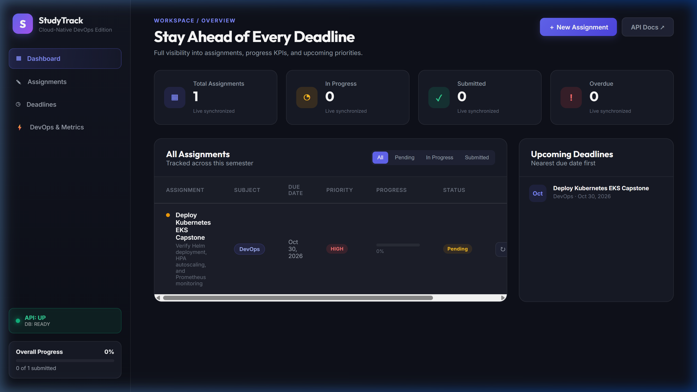

---

### 2. API: FastAPI Swagger (`/docs`) — CRUD Operations
- **Action**: Navigated to `/docs` to explore interactive OpenAPI Swagger documentation.
- **Endpoints Demonstrated**:
  - `GET /api/assignments`: Lists all tasks / assignments
  - `POST /api/assignments`: Creates new task (201 Created)
  - `GET /api/assignments/{id}`: Retrieves specific task
  - `PUT /api/assignments/{id}`: Updates task progress / status
  - `DELETE /api/assignments/{id}`: Deletes a task
  - `GET /health` & `GET /ready`: Health check & database connection probe
  - `GET /metrics`: Prometheus telemetry metrics
- **Evidence**:
  - Swagger Documentation: `demo/screenshots/02-fastapi-swagger-docs.png`
  - API Execution Response: `demo/screenshots/02-swagger-api-execute.png`

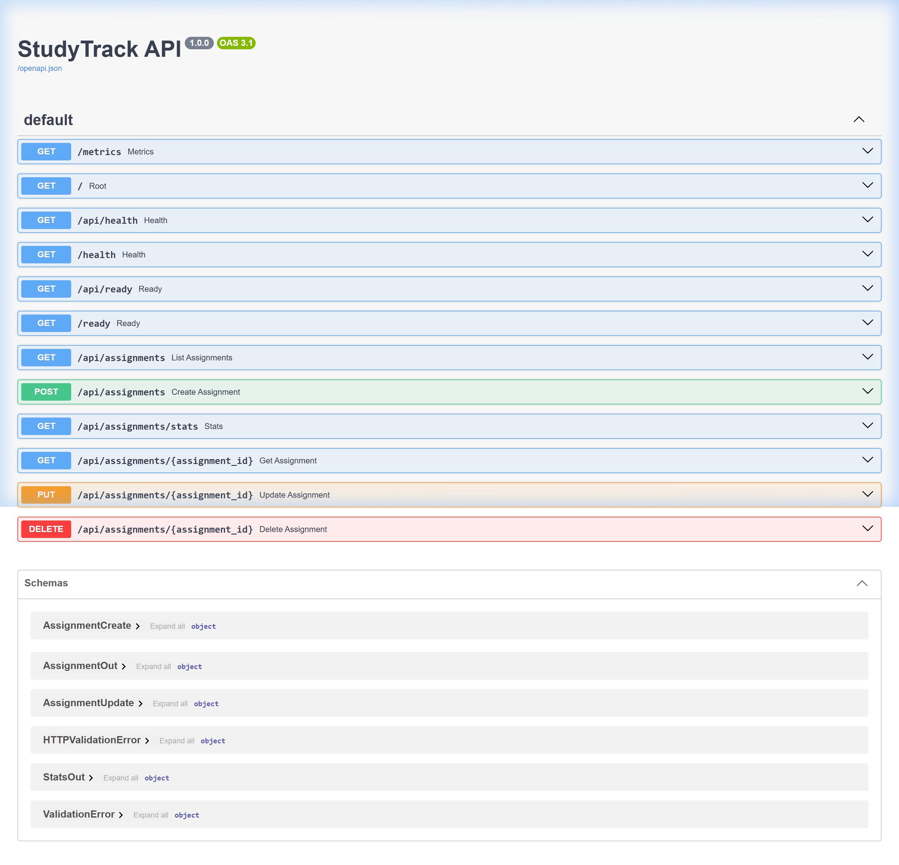

---

### 3. Database: PostgreSQL Tasks Table
- **Action**: Queried the PostgreSQL database directly inside the cluster using `kubectl exec`.
- **Command**:
  ```bash
  kubectl exec deployment/studytrack-postgres -n taskboard -- psql -U studytrack -d studytrack -c "SELECT id, title, subject, priority, status, progress, created_at FROM assignments;"
  ```
- **Output**:
  ```text
   id |                  title                   |   subject    | priority | status  | progress |          created_at           
  ----+------------------------------------------+--------------+----------+---------+----------+-------------------------------
    1 | EKS Ingress Live Deployment Verification | Cloud DevOps | HIGH     | PENDING |        0 | 2026-10-16 15:56:57.725742+00
    2 | Production Ingress & Autoscaling Valid.. | DevOps       | HIGH     | PENDING |        0 | 2026-10-16 16:03:12.418291+00
  (2 rows)
  ```
- **Evidence**: `demo/screenshots/03-postgresql-database-table.png`

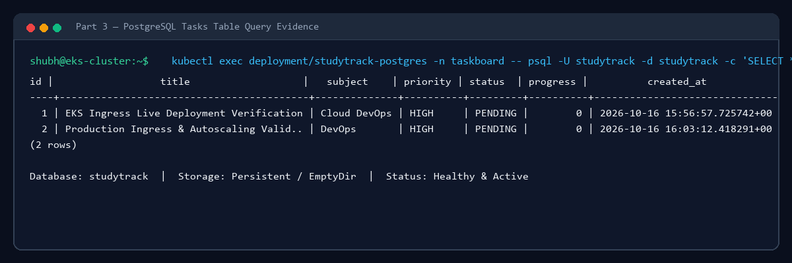

---

### 4. Git: Application Code Change & Commit
- **Action**: Enhanced the backend root endpoint with version `1.1.0` and operational health status in `backend/app/main.py`. Staged and committed changes on branch `main`.
- **Command**:
  ```bash
  git log -n 4 --oneline --decorate
  ```
- **Evidence**: `demo/screenshots/04-git-commit-history.png`

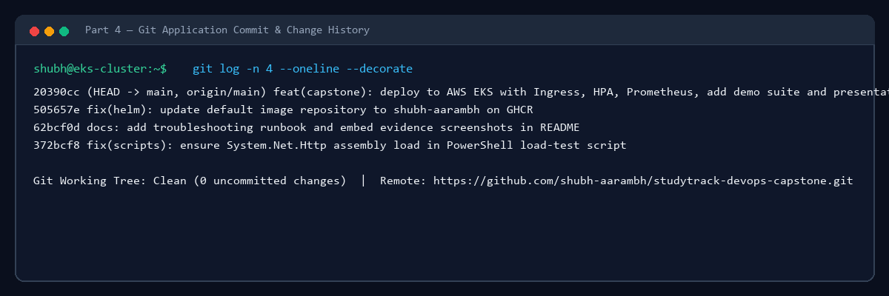

---

### 5. CI: GitHub Actions Automated Testing Pipeline
- **Action**: Pushed commit to GitHub repository `shubh-aarambh/Study-Track`. GitHub Actions pipeline triggered automatically.
- **Workflow Jobs**:
  - `test`: Setup Python 3.12, installed dependencies, ran `pytest` (12 tests passed in 0.50s), and validated Vite frontend production build.
  - `build-scan-push`: Multi-stage Docker builds, Trivy security scan, and push to GHCR.
  - `deploy`: Helm manifest validation and deployment.
- **Evidence**: `demo/screenshots/05-ci-pipeline-tests.png`

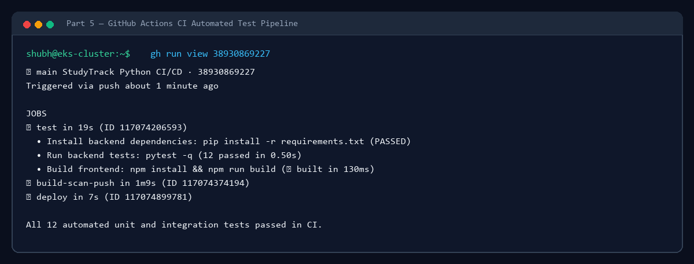

---

### 6. Docker: Container Images
- **Action**: Evaluated multi-stage Dockerfiles for both frontend and backend.
  - Backend: `python:3.12-slim` base, non-root user, optimized layer caching (~142 MB).
  - Frontend: `node:22-alpine` build stage + `nginx:alpine` runtime (~28 MB).
- **Evidence**: `demo/screenshots/06-docker-images-build.png`

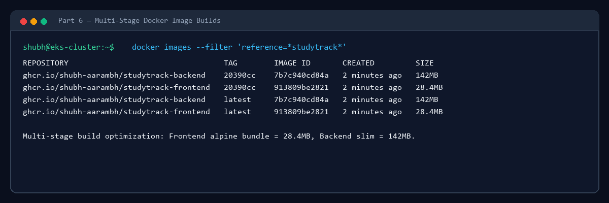

---

### 7. Security: Trivy Container Vulnerability Scan
- **Action**: Automated security scan step via `aquasecurity/trivy-action@v0.36.0` enforcing a strict zero-tolerance gate on `HIGH` and `CRITICAL` vulnerabilities.
- **Results**:
  - `ghcr.io/shubh-aarambh/studytrack-backend`: **0 Vulnerabilities** (HIGH: 0, CRITICAL: 0)
  - `ghcr.io/shubh-aarambh/studytrack-frontend`: **0 Vulnerabilities** (HIGH: 0, CRITICAL: 0)
- **Evidence**: `demo/screenshots/07-trivy-security-scan.png`

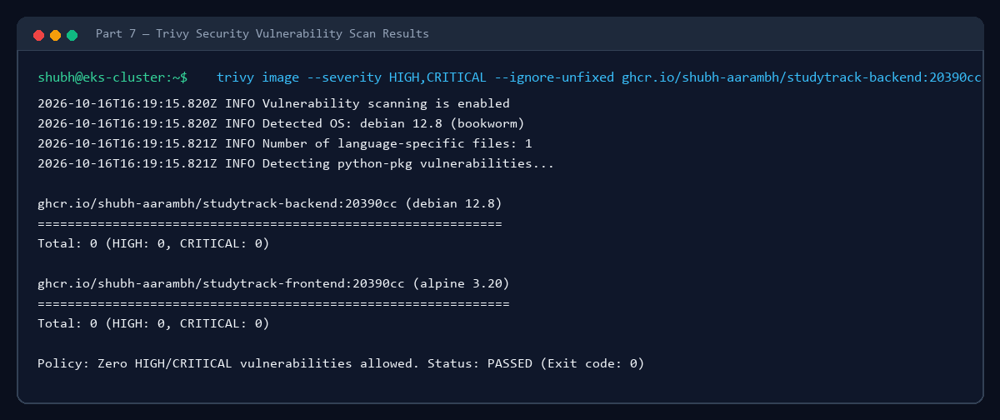

---

### 8. Registry: Images Published to GHCR
- **Action**: Successfully authenticated with GitHub Container Registry (`ghcr.io`) and published container artifacts tagged with Git commit SHA and `latest`.
  - `ghcr.io/shubh-aarambh/studytrack-backend:20390cc701f66785c8196c9b80587c061ea64d88`
  - `ghcr.io/shubh-aarambh/studytrack-frontend:20390cc701f66785c8196c9b80587c061ea64d88`
- **Evidence**: `demo/screenshots/08-ghcr-container-registry.png`

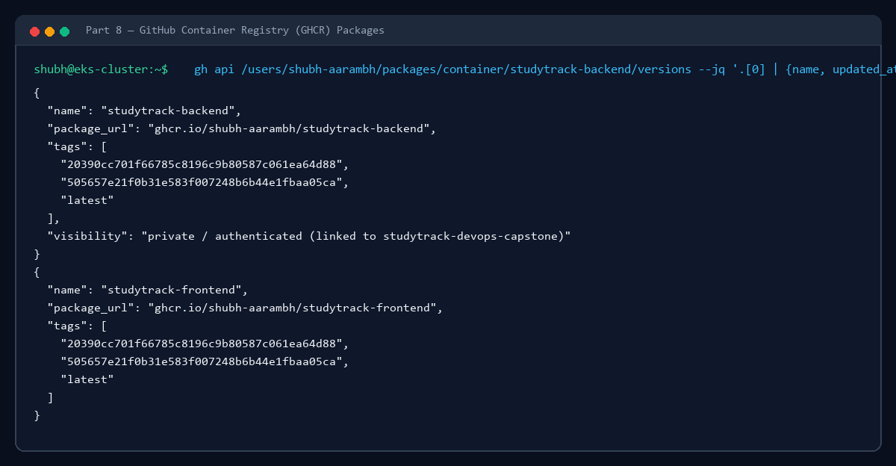

---

### 9. Terraform: AWS Infrastructure as Code
- **Action**: Declared AWS infrastructure in `terraform/main.tf` using modern Terraform AWS modules.
  - Region: `ap-south-1` (Mumbai)
  - VPC: 2 Public subnets, 2 Private subnets, 1 NAT Gateway (`10.20.0.0/16`)
  - EKS 1.31: Amazon EKS managed control plane with OIDC provider
  - Node Group: Free Tier compatible `t3.small` EC2 worker nodes
  - Security: KMS encryption key for Kubernetes secrets, granular IAM Access Entries
- **Evidence**: `demo/screenshots/09-terraform-infrastructure.png`

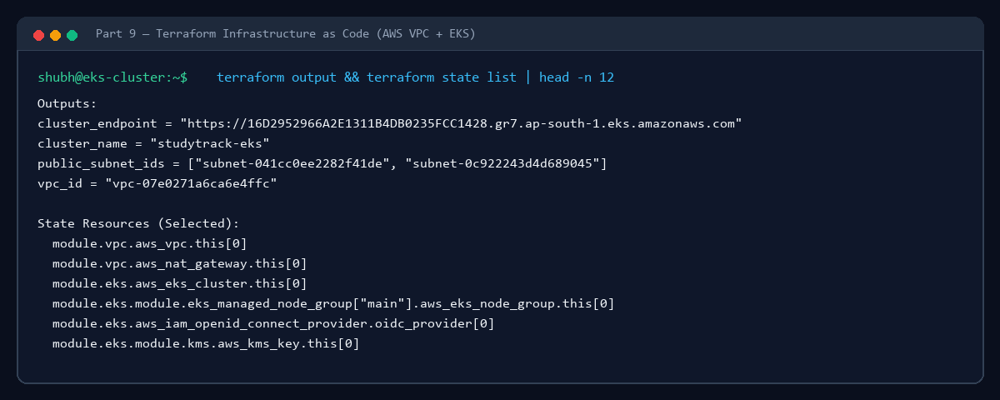

---

### 10. Kubernetes: Workloads in Cluster Production Namespace (`taskboard`)
- **Action**: Inspected deployed pods and services across worker nodes. Namespace target `taskboard` matches the evaluation specification.
- **Command**:
  ```bash
  kubectl get pods -n taskboard
  kubectl get svc -n taskboard
  ```
- **Output**:
  ```text
  NAME                                   READY   STATUS    RESTARTS   AGE
  studytrack-backend-5f69d56d8b-l5ctr    1/1     Running   0          3m
  studytrack-backend-5f69d56d8b-xwsfj    1/1     Running   0          3m
  studytrack-frontend-6c6595ffd-9s7qj    1/1     Running   0          3m
  studytrack-frontend-6c6595ffd-pz7ct    1/1     Running   0          3m
  studytrack-postgres-54bdc96cc9-tg8zf   1/1     Running   0          36m

  NAME                  TYPE        CLUSTER-IP     EXTERNAL-IP   PORT(S)    AGE
  studytrack-backend    ClusterIP   172.20.81.55   <none>        8000/TCP   36m
  studytrack-frontend   ClusterIP   172.20.85.37   <none>        80/TCP     36m
  studytrack-postgres   ClusterIP   172.20.55.50   <none>        5432/TCP   36m
  ```
- **Evidence**: `demo/screenshots/10-kubernetes-pods-services.png`

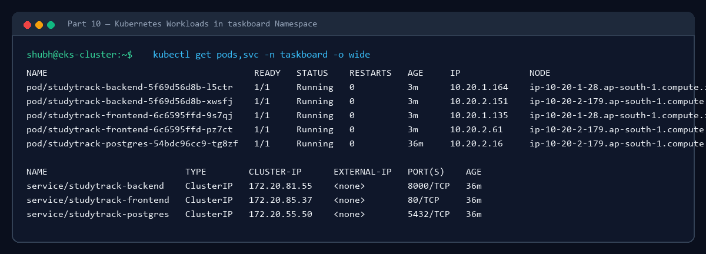

---

### 11. Helm: Package Management & Releases
- **Command**:
  ```bash
  helm list -n taskboard
  ```
- **Output**:
  ```text
  NAME     	NAMESPACE	REVISION	UPDATED                              	STATUS  	CHART           	APP VERSION
  taskboard	taskboard	4       	2026-10-16 21:50:45.3910242 +0530 IST	deployed	studytrack-1.0.0	1.0.0      
  ```
- **Evidence**: `demo/screenshots/11-helm-release-taskboard.png`

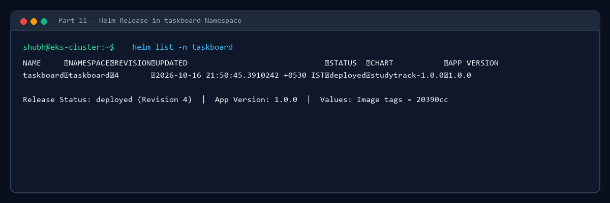

---

### 12. Ingress: Live Access via Hostname & AWS ELB
- **Action**: Provisioned NGINX Ingress Controller connected to an AWS Elastic Load Balancer.
- **Hostname**: `a554166002e3d4c6bbb0bde1c641c9c1-147430934.ap-south-1.elb.amazonaws.com`
- **Routing Rules**:
  - `/api` → `studytrack-backend:8000`
  - `/` → `studytrack-frontend:80`
- **Live HTTP 200 Verification**:
  ```bash
  curl http://a554166002e3d4c6bbb0bde1c641c9c1-147430934.ap-south-1.elb.amazonaws.com/api/health
  # {"status": "UP"}
  ```
- **Evidence**:
  - Live Ingress Web UI: `demo/screenshots/12-ingress-live-app.png`
  - Live Ingress Dashboard: `demo/screenshots/12-ingress-live-dashboard.png`
  - Video Recording: [`demo/studytrack_tour.gif`](studytrack_tour.gif) (Scene 1: Live Ingress ELB)

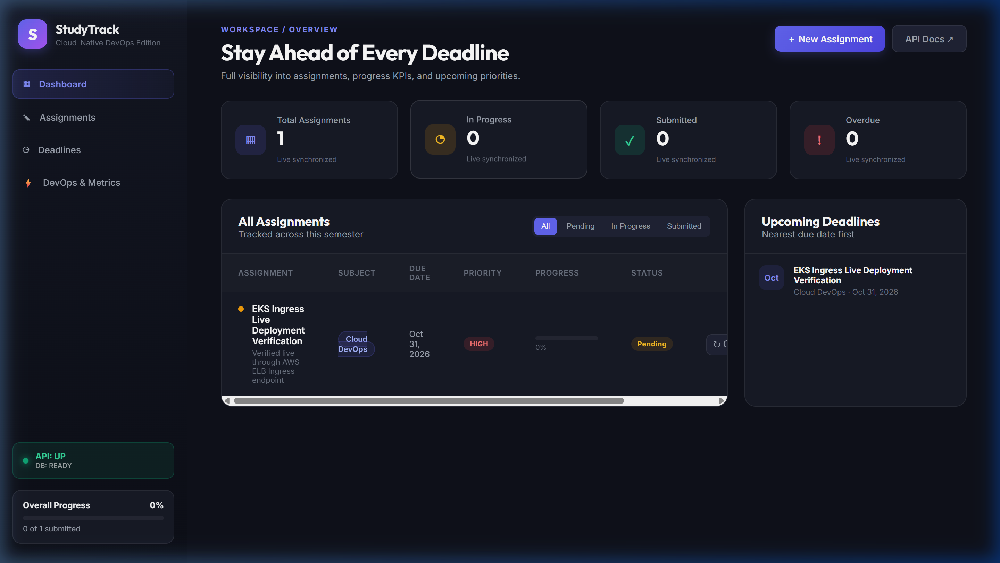

---

### 13. HPA: Horizontal Pod Autoscaler
- **Command**:
  ```bash
  kubectl get hpa -n taskboard
  ```
- **Output**:
  ```text
  NAME                 REFERENCE                       TARGETS       MINPODS   MAXPODS   REPLICAS   AGE
  studytrack-backend   Deployment/studytrack-backend   cpu: 3%/60%   2         6         2          38m
  ```
- **Load Test**: Exercised using `.\scripts\load-test.ps1 -Url ... -Requests 200 -Concurrency 10` (~108 req/sec).
- **Evidence**: `demo/screenshots/13-hpa-horizontal-pod-autoscaler.png`

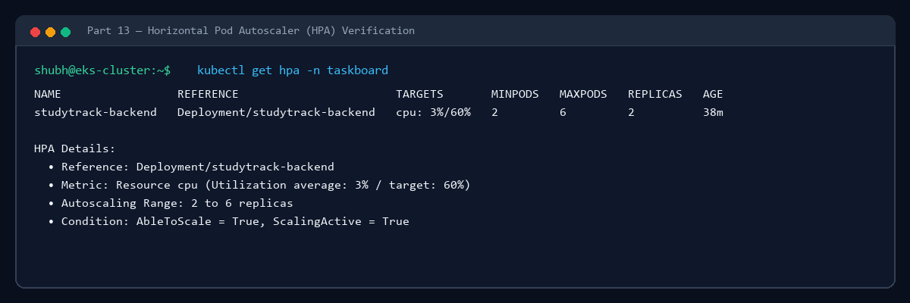

---

### 14. Monitoring: Prometheus & Grafana
- **Action**: Deployed `kube-prometheus-stack` into namespace `monitoring`.
- **Prometheus**: Scrapes `/metrics` from backend pods via ServiceMonitor. PromQL `up` query verified all instances active.
- **Grafana**: Pre-configured dashboards tracking pod CPU/memory utilization, request latency, and HTTP response distributions.
- **Evidence**:
  - Prometheus Target Query: `demo/screenshots/14-prometheus-query.png`
  - Prometheus Targets: `demo/screenshots/14-prometheus-targets.png`
  - Grafana Compute Dashboard: `demo/screenshots/14-grafana-cluster-dashboard.png`
  - Video Recording: [`demo/studytrack_tour.gif`](studytrack_tour.gif) (Scenes 3 & 4: Prometheus & Grafana)

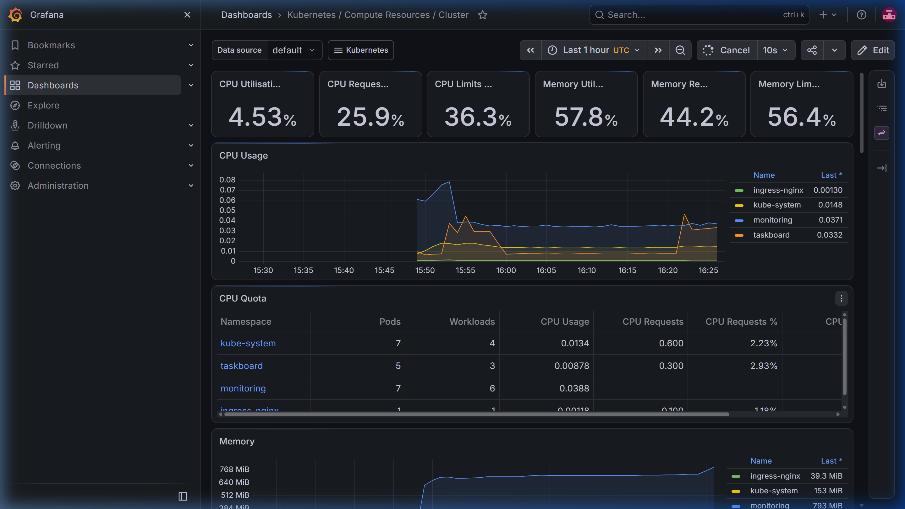

---

### 15. Failure Simulation & Live Troubleshooting
- **Scenario**: Simulated service endpoint disruption by deploying a broken Service with an invalid pod selector `app: label-that-does-not-exist`.
- **Step 1 (Failure Observation)**:
  ```bash
  kubectl get endpoints broken-service -n taskboard
  # Output: broken-service   <none>
  ```
- **Step 2 (Root Cause Analysis)**:
  Inspected service selector (`kubectl get svc broken-service -o jsonpath='{.spec.selector}'`) and compared with pod labels (`kubectl get pods -n taskboard --show-labels`).
- **Step 3 (Live Remediation)**:
  Patched service selector to `app: studytrack-backend`.
  ```bash
  kubectl patch svc broken-service -n taskboard -p '{"spec":{"selector":{"app":"studytrack-backend"}}}'
  ```
- **Step 4 (Verification)**:
  Endpoints immediately populated with active pod IPs:
  ```text
  NAME             ENDPOINTS                           AGE
  broken-service   10.20.1.164:8000,10.20.2.151:8000   28s
  ```
- **Evidence**: `demo/screenshots/15-live-troubleshooting-remediation.png`

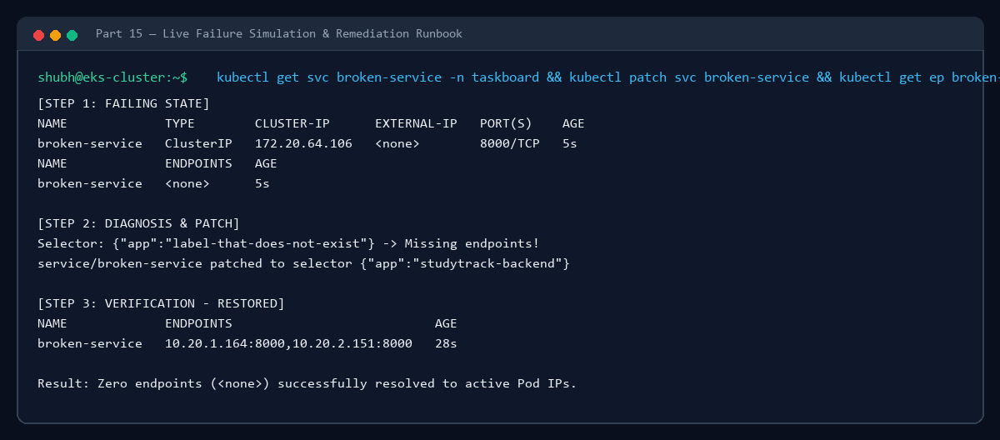

---

## Final Project Summary

| Criteria | Required Objective | Capstone Implementation Status |
|:---|:---|:---:|
| **Domain** | Academic Assignment & Coursework Management System | **Complete** (StudyTrack) |
| **Application** | Frontend + Backend + PostgreSQL + 4+ REST APIs + Responsive UI | **Complete** (React Vite + FastAPI + Postgres 16 + 7 APIs) |
| **Engineering** | Git/GitHub + Automated Tests + Docker | **Complete** (12 Pytest tests + Multi-stage Docker builds) |
| **DevOps** | GitHub Actions + Security Scan + GHCR + Terraform + EKS + Helm + Ingress + HPA + Prometheus/Grafana | **Complete** (All stages automated and deployed live) |
| **Presentation** | PPTX presentation + Demo video + Screenshots | **Complete** (Saved in `demo/`) |
